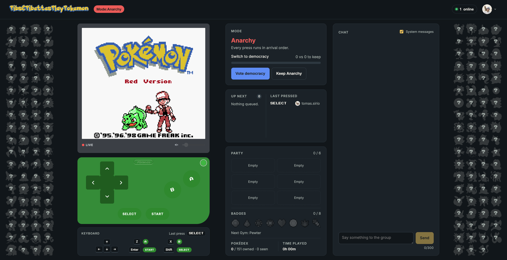
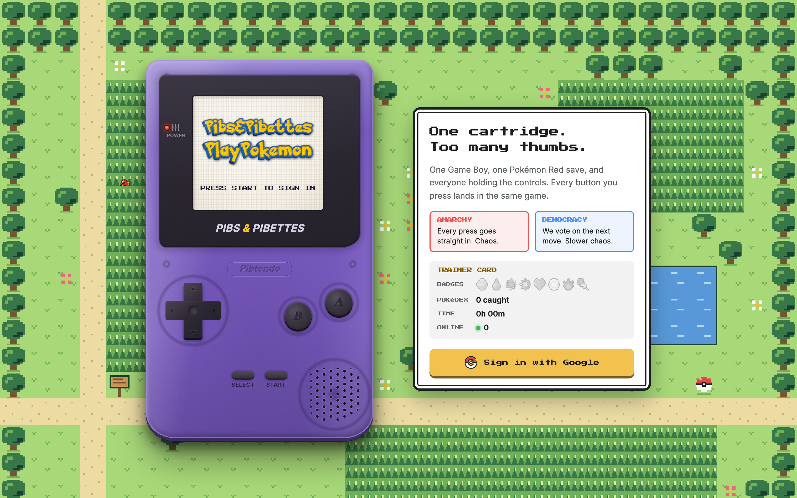

<p align="center">
  
</p>

<p align="center">
  
</p>

One Game Boy, one cartridge, everyone on the same save. Every signed-in player's button presses go into the same
Pokémon Red. It's Twitch Plays Pokémon, but private: a group of friends, a browser, and a lot of walking into walls.



## What it does

- **Shared emulator.** The server runs the Game Boy ([Coffee GB](https://github.com/trekawek/coffee-gb)) and streams
  the screen and sound to every browser over WebSockets. Players send presses. The server is the only one playing.
- **Anarchy and Democracy.** In Anarchy every press is queued and run in order. In Democracy the server collects votes
  for a few seconds and runs the winner. Players can vote to switch modes; the thresholds are set by an admin.
- **Inputs.** On-screen pad, keyboard, or (if enabled) chat. Short sequences like `left2down2` or `a3` are allowed in
  Anarchy, at most 5 steps. Rate limited per player.
- **The game talks back.** The server reads Pokémon Red's RAM and announces badges, catches, level-ups, evolutions,
  faints, new towns and blackouts, with who pressed last. The side panels show the party, badges and Pokédex.
- **Chat and presence.** Live chat with Pikachu-face reactions, who's online, who pressed what, what's up next in the queue.
- **Pick a shell.** The pad can be a classic Game Boy or one of ~25 Game Boy Color colours. Dark, light or auto theme.
- **Phones.** Portrait and landscape layouts of their own, not a squashed desktop page.
- **Welcome screen.** A Kanto-style overworld where the trainer (sprite read from the inserted ROM) walks around with
  the party, plus a trainer card with the run's badges, Pokédex, play time and who's online.
- **Who gets in.** Google sign-in for emails on the allowlist. Anyone else who signs in becomes an access request
  that an admin accepts or rejects. Revoking someone ends their sessions.
- **Admin.** Upload cartridges, power/reset/pause/speed, save states and scheduled autosaves, a countdown that powers
  the Game Boy on at a set time, input and rate-limit settings, chat moderation, and a factory reset (type `RESET`)
  that wipes the run but keeps players, settings and ROMs.



<!-- TODO: screenshots of /play and /admin; uncomment once docs/screenshots/{play-dark,play-light,play-mobile,admin}.png exist
## Screenshots

| Desktop (dark) | Desktop (light) |
| --- | --- |
|  |  |

| Phone | Admin |
| --- | --- |
|  |  |
-->

## How it's built

```
browser ──HTTP/SSE──▶ nginx ──▶ Spring Boot ──▶ Redis   (queue, votes, chat, settings, sessions)
   ▲                              │
   └──── screen + audio (WS) ─────┘ Coffee GB on its own thread, ROMs / saves / states on disk
```

| Part | Stack |
| --- | --- |
| `backend/` | Java 21, Spring Boot 3.5, Maven modules: `pppp-emulator` (Coffee GB wrapper, no Spring), `pppp-core` (services, Redis repositories, jobs), `pppp-app` (controllers, security, SSE and WebSockets) |
| `frontend/` | SvelteKit + Svelte 5 runes, TypeScript, Vite, static SPA served by nginx |
| Auth | Google sign-in (OIDC), only for emails on the allowlist. Sessions in Redis |
| Live updates | Server-sent events (`/api/v1/events`) for chat, votes, game events; WebSockets for screen and audio |

Not included: ROMs. Bring your own legally dumped cartridge and upload it from the admin page (or drop it in
`data/roms/`).

## Running it

You need Java 21, Maven, Node 22+, Docker (for Redis and the integration tests), and a Google OAuth client with
`http://localhost:5173/login/oauth2/code/google` as a redirect URI.

```sh
cp .env.example .env            # fill in GOOGLE_CLIENT_ID, GOOGLE_CLIENT_SECRET, PPPP_ADMINS (your email)
docker compose up -d redis

# backend on :8080
cd backend
mvn -q clean package -DskipTests
set -a; . ../.env; set +a
java -jar pppp-app/target/pppp-app-*.jar

# frontend on :5173 (proxies /api, /ws, /oauth2 to :8080)
cd frontend
npm install
npm run dev
```

Open http://localhost:5173, press START, sign in. The emails in `PPPP_ADMINS` become the first admins; add everyone
else from `/admin`.

`docker compose up` builds and runs Redis and the backend together. The frontend has its own `Dockerfile` (nginx).

## Deploying

Pushes to `main` run [`.github/workflows/deploy.yml`](.github/workflows/deploy.yml): tests, images to
`ghcr.io/<owner>/pppp-{backend,frontend}`, then `helm upgrade --install` of `backend/chart` and `frontend/chart` on a
k3s cluster (reached over Twingate). Both run as StatefulSets; it's exposed through a Cloudflare Tunnel, no ingress.
Pull requests only run the tests.

## Tests

```sh
cd backend && mvn -q test                                  # unit + integration (Testcontainers Redis)
cd frontend && npm run check && npm test && npm run build
```

## Configuration

| Variable | Default | |
| --- | --- | --- |
| `GOOGLE_CLIENT_ID` / `GOOGLE_CLIENT_SECRET` | | Google OAuth client |
| `PPPP_ADMINS` | | Comma-separated emails seeded as admins when the allowlist is empty |
| `REDIS_HOST` / `REDIS_PORT` | `localhost` / `6379` | |
| `PPPP_DATA_DIR` | `./data` | ROMs, battery saves, save states |

Everything else (mode, democracy window and thresholds, queue length, rate limit, autosave cron) is changed at
runtime from the admin page.

## Not affiliated

Fan project for friends. Not affiliated with Nintendo, Game Freak or The Pokémon Company. Pokémon is their trademark.
